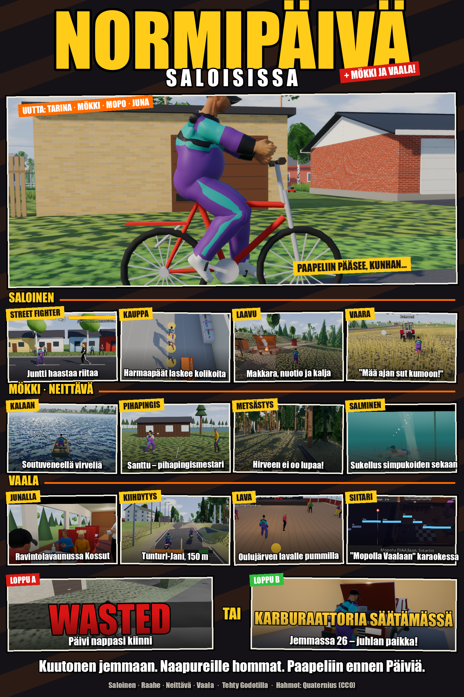

# Normipäivä Saloisissa

GTA-tyylinen 3D-peli: aja pyörällä Järvikuja 1:stä K-Marketille, osta kuutonen ja aja kotiin.
Matkalla vaanii vaimo Päivin punainen Hyundai, kassalla harmaapäät laskevat kolikoita, naapurin Anna-Liisa
voi käräyttää ja paikallinen juntti (Raahen karateklubin perustaja) haastaa Street Fighter -tappeluun.

## Pelaa

- **Selaimessa:** https://desmondx80.github.io/normipaiva/ (puhelin ja tabletti: kosketusohjaimet)
- **Windows ja Mac:** [Releases → Normipäivä (uusin main)](https://github.com/DesmondX80/normipaiva/releases/tag/latest)

GitHub Actions buildaa ne automaattisesti jokaisesta mainin pushista (`.github/workflows/release.yml`).
Peliä ei ole allekirjoitettu: Windowsissa valitse SmartScreen-varoituksesta *Lisätietoja → Suorita silti*,
Macissa *Järjestelmäasetukset → Tietosuoja ja suojaus → Avaa silti*.
Jos Windows-versio näyttää hetken mustaa ja sulkeutuu, käynnistä se tiedostolla `Normipaiva (yhteensopiva).bat`
(kevyempi OpenGL-grafiikka). Peli muistaa valinnan, joten sen jälkeen myös `Normipaiva.exe` toimii.
Grafiikkamoottorin voi vaihtaa myös kohdasta Asetukset → Grafiikka (vaihtuu uudelleenkäynnistyksessä).
Loki: `%APPDATA%\Godot\app_userdata\Normipäivä\logs\godot.log`.

## Lyhyesti

- Saloisten kylä OpenStreetMapista: kauppareissu pyörällä, Päivin kauppalista värikynillä ja kaljajemmat.
- Vaarat: Päivin punainen Hyundai, naapurin Anna-Liisa, juntti ja mummot kettukarkkeineen.
- Tarina "Paapeliin pääsee, kunhan…" ja sen jatko: Paapelin mökki, mopolla Vaalaan ja junalla kotiin.
- Kymmeniä minipelejä: marjat, nurmikko, sahaus, kalastus, kädenvääntö, tanssit, bingo, Street Fighter -tappelut…
- Kylän legendat, sivutehtävät ja onnelliset loput Normipäiväkirjassa (O).

## Ohjaus lyhyesti

| | |
|---|---|
| W A S D | liiku, polje ja ohjaa |
| E | toiminto (puhu, osta, ovet) |
| F | pyörän selkään / pois |
| Shift | juoksu / spurtti |
| T | syö ja juo |
| I / M / O | reppu / kartta / päiväkirja |
| Esc | valikko |

Kaikki näppäimet, minipelit ja kosketusohjaus: [docs/ohjaus.md](docs/ohjaus.md).

## Dokumentaatio

- [Pelin sisältö](docs/pelin-sisalto.md): kaikki paikat, tehtävät ja legendat (juonipaljastuksia!)
- [Päivittäiset tilat](docs/tilat.md): HUD:n tilat, palkinnot, haitat ja toimintojen vaikutukset
- [Ohjaus](docs/ohjaus.md)
- [Kehitys](docs/kehitys.md): Godot-käynnistys, kääntyvyys, testikohtaukset ja karttadata
- [Tekijänoikeudet ja lisenssit](docs/tekijanoikeudet.md)

## Kehittäjälle

Godot **4.7** (CI: 4.7.2). Avaa `project.godot` editorissa tai aja `godot --path .`. Skriptit ladataan
`preload`:lla (ei `class_name`), ja `tools/testit/kaantyyko.sh` tarkistaa, että peli kääntyy ilman editoria.
Lisää: [docs/kehitys.md](docs/kehitys.md) ja [CLAUDE.md](CLAUDE.md).

## Tekijänoikeudet

Koodi ja maisema on tehty tätä peliä varten. Kartat © OpenStreetMap-tekijät (ODbL), korkeudet © Maanmittauslaitos
(CC BY 4.0), hahmot Quaternius (CC0), äänet CC0 ja musiikki CC BY / Public Domain. Täydet tiedot:
[docs/tekijanoikeudet.md](docs/tekijanoikeudet.md).
